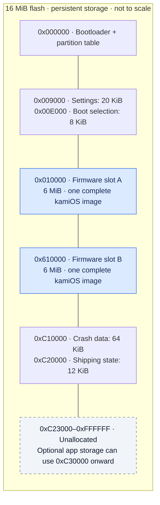
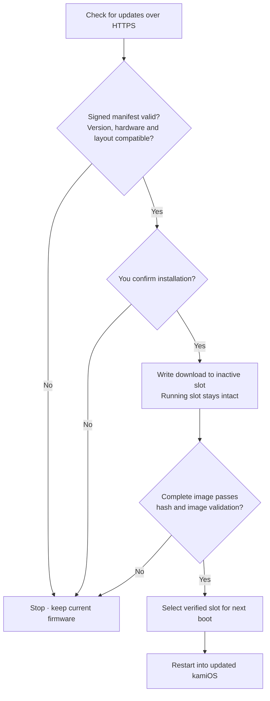
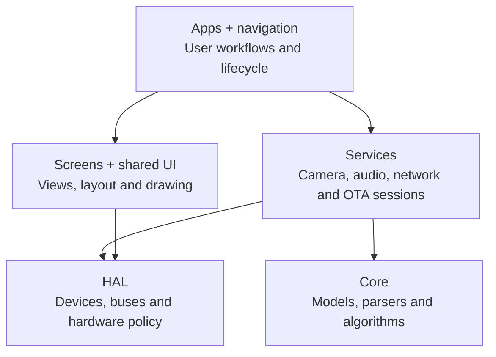

<p align="center">
  
</p>
<h1 align="center">kamiOS 1.0</h1>
<p align="center"><strong>Origami Computing</strong></p>

kamiOS is the operating firmware for Origami’s ESP32-S3 handheld: a display, camera, audio, motion sensing, and Lua widgets in one device.

Official releases are published after source review, automated checks, and qualification of the signed candidate. See [release review](docs/release-review.md).

## Build your own app

Describe an idea to your coding assistant and give it the [Origami app builder skill](skills/origami-app-builder/SKILL.md). Start with Lua: small games, clocks, interactive tools and data screens can run from the SD card without rebuilding firmware. The skill includes a [ready-to-copy counter](skills/origami-app-builder/assets/counter/main.lua), the supported Lua API and C++ guidance for deeper hardware features.

With a skill-compatible assistant, copy the entire `skills/origami-app-builder` folder into its skills directory and invoke `$origami-app-builder`. In Codex, that directory is `~/.codex/skills/`. Other assistants can read `SKILL.md` and its linked references directly from this checkout.

Try: “Use the Origami app builder skill to make a breathing app with a gentle animation and rotary speed control.” Lua supports the device's exposed capabilities; arbitrary network, storage and hardware access need native integration.

## Hardware

The supported target is rev-4 ESP32-S3 N16R8: 16 MB flash, 8 MB octal PSRAM, a 240 × 280 ST7789 display, and a TCA6424A I/O expander. Firmware for other boards is not interchangeable.

## Build

Install PlatformIO Core 6.2.0 in a dedicated Python environment, then run:

```sh
pio run -e esp32-s3-menu-n16r8-production
```

This produces a **custom production-policy build**, not an official signed OTA release. The pinned Arduino framework, libraries, and compatibility wrappers are part of the build contract. See [building](docs/building.md).

## Updates and downloads

For a normal update, use **Update Firmware** on the device, review the offered version, and confirm installation over Wi-Fi. Read the [release log](CHANGELOG.md) for exactly what changed since the previous version.

For manual downloads, open the [latest release](https://github.com/Origami-Computing/origami-firmware-public/releases/latest):

| Download | Choose this when… |
| --- | --- |
| **firmware.bin** | You need the application image for an existing compatible device. |
| **kamiOS-vX.Y.Z.zip** | You want the complete release bundle: the same image, release notes, corresponding source, licenses and verification files. |

There is **one release ZIP**. GitHub's additional “Source code (zip)” and “Source code (tar.gz)” links are [automatic repository snapshots](https://docs.github.com/en/repositories/releasing-projects-on-github/about-releases), not install packages; you do not need them to update. The complete bundle is not a factory installer either. The source version is in `platformio.ini`; main may contain changes newer than the published release.

## Where firmware and custom apps live



**Either firmware slot can be active.** The other is the OTA download target—not custom-app storage. [Partition source](partitions_ota_n16r8.csv).

| Storage | What lives here | Survives power-off? |
| --- | --- | --- |
| Flash | Firmware, settings and system state | Yes |
| SD card | Photos, video, recordings, Lua widgets; native apps when app flash is absent | Yes |
| 8 MiB PSRAM | Working memory for running code, images and buffers | No |

| Custom app type | Installation and limits |
| --- | --- |
| Lua widget | Runs from SD; no firmware rebuild. |
| Signed native app | Installed through App Store; ELF payload up to 512 KiB, subject to available memory and API compatibility. |
| C++ built into kamiOS | Requires a firmware build; the complete OS must fit one 6 MiB slot. |
| Optional native-app flash | About 3.8 MiB at `0xC30000` (`0x3D0000` bytes). **Not enabled by the current partition table.** Needs a verified partition migration; OTA alone does not create it. |

## How OTA works



| Normal OTA changes | Normal OTA preserves |
| --- | --- |
| Inactive firmware image; next-boot selection after validation | Settings, SD files, any existing custom-app partition, bootloader and partition layout |

| Update channel | Access |
| --- | --- |
| Public, since v1.0.5 | No OTA enrollment key needed. |
| Private / Staging | Developer authorization required. |

Backend account setup is separate. Two slots do not guarantee automatic recovery after a bad boot; recovery depends on the installed bootloader and device state.

## OTA not working? Recover over USB

**[Open the Kami recovery page](https://origami-computing.github.io/origami-firmware-public/)** in desktop Chrome or Edge.

| Step | What to do |
| --- | --- |
| 1. Connect | Use a USB data cable and close other device tools. Click **Connect my Kami**. |
| 2. Recover | Choose **Install Public** and keep the cable connected until verification finishes. |
| 3. Update | Restart Kami, connect to Wi-Fi, then use **Update Firmware** for the latest Public release. |

The page currently installs Public **v1.0.5** as a recovery bridge, not the latest release. It checks the existing layout and is designed to preserve account pairing, Wi-Fi, settings and SD files. Unsupported layouts stop before writing. It is for existing supported 16 MB Kami devices, not blank-device setup or recovery of deleted files. If it cannot connect or rejects the layout, follow its troubleshooting guidance or contact support; do not erase the device.

## If you need to flash over USB

**Never write `firmware.bin` at address zero or erase the whole device.** It is an application image, not a factory installer.

| Situation | Use |
| --- | --- |
| Working device, normal upgrade | On-device **Update Firmware**. |
| OTA failure on a supported existing device | [Guided USB recovery](https://origami-computing.github.io/origami-firmware-public/), then update on-device. |
| Developer needs manual flashing | Application-only flashing into the confirmed boot slot. |
| Blank device or damaged partition table | Matching factory/recovery package and provisioning procedure; this release ZIP is insufficient. |

| USB step | Required check |
| --- | --- |
| 1. Identify | Rev-4 ESP32-S3 N16R8; inspect the installed partition table and boot selection. |
| 2. Preserve | Private backup of settings and boot/partition data; one serial connection; stable power. |
| 3. Write | Verify the download hash. Write only the confirmed application slot: normally `0x10000` or `0x610000`, **never a guessed address**. |
| 4. Verify | Check written bytes, reboot, and confirm version, settings, SD access and affected features. |

Read [installation and recovery](docs/installation.md) first. SD artwork is under `sd_flash/` in the source companion.

## Architecture at a glance



| Owner | Keeps responsibility for |
| --- | --- |
| App | What the user is doing and how long the workflow lasts. |
| Screen / UI | What is shown and how it is drawn. |
| Service | Starting, cancelling and cleaning up operations. |
| Core / HAL | Reusable logic / controlled access to hardware. |

[Architecture details](docs/architecture.md) cover lifecycle, resource ownership and OTA handoff.

## Explore

- [Architecture and ownership](docs/architecture.md)
- [Build and verification](docs/building.md)
- [SDK license and security review](docs/sdk-review.md)
- [Private-to-public promotion runbook](docs/public-promotion.md)
- [Contribution guide](CONTRIBUTING.md)
- [Security reporting](SECURITY.md)
- [Third-party notices](THIRD_PARTY_NOTICES.md)

## License

Origami’s original source is offered under [MIT](LICENSE), as selected for this migration. Existing third-party licenses continue to govern their respective components. Origami confirmed ownership of its artwork and generated font for this migration. Upstream components retain their own licenses; see [distribution requirements](docs/distribution.md).
