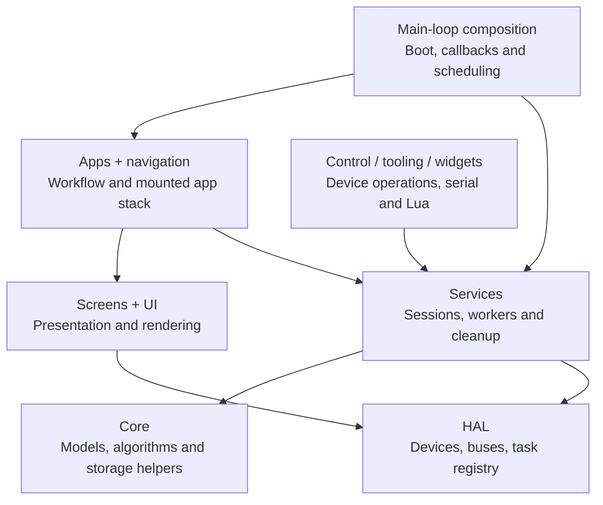
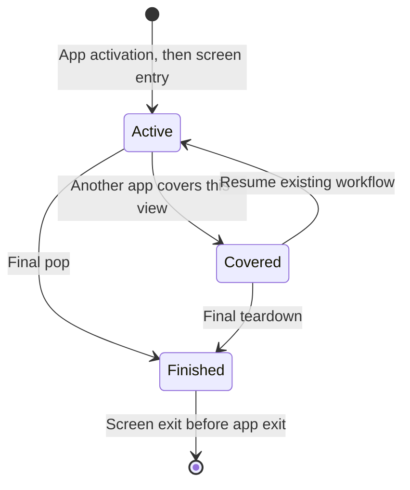
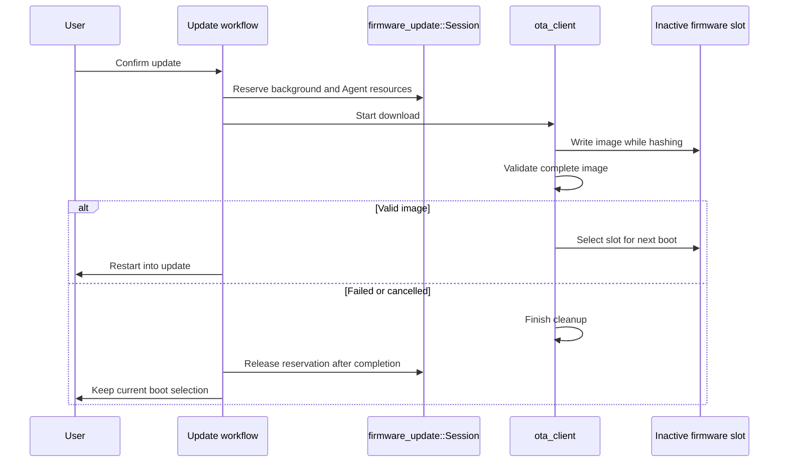
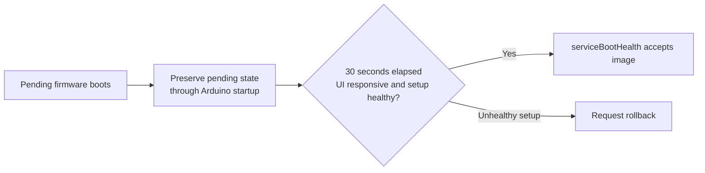
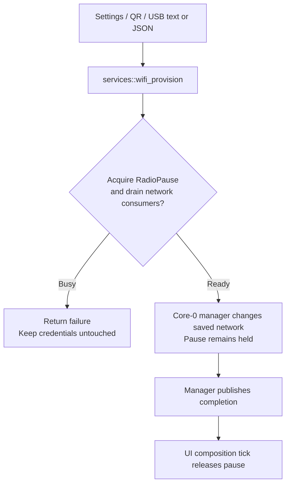

# Architecture

ESP32-S3 · Arduino · FreeRTOS. [`src/main_menu.cpp`](../src/main_menu.cpp) composes boot, services, navigation and the UI loop. Interfaces generally live in `include/`; implementations in `src/`.

## Ownership and dependencies

Arrows show principal call/dependency directions, not every permitted include.

| Area | Owns |
| --- | --- |
| `apps`, `nav_handler` | User decisions, input routing, activation, cover/resume and final exit |
| `scene`, `ui` | Screen callbacks, geometry, drawing and framebuffer/direct-panel presentation |
| `services` | Camera/audio sessions, network work, OTA, persistence operations and resource coordination |
| `core` | Models, parsers, DSP, storage helpers, policy and credential snapshots |
| `hal` | Devices, buses, task registry and hardware policy |
| `control`, `tooling`, `widgets` | Shared device operations, serial adapters and Lua integration |
| `sfx` | Sound definitions and playback composition |

| Dependency rule | Enforcement limit |
| --- | --- |
| Core, services and SFX cannot import app/navigation/presentation interfaces, even indirectly | The [dependency guard](../tools/check_architecture_dependencies.py) checks includes, not runtime race freedom |
| Core cannot import services | Operational coordination stays above core |

## App and resource lifetime

| Event | Contract |
| --- | --- |
| Screen entry | Refresh a view; not a new app activation |
| Cover / resume | Keep the workflow mounted; release/recover view-scoped resources |
| Final exit | Release workflow-owned service sessions |
| Service cancellation | Wait for acknowledgment before freeing buffers or handing back shared peripherals |

## OTA ownership and handoff

| Concern | Contract |
| --- | --- |
| Resource reservation | `firmware_update::Session` coordinates background and Agent resources |
| Download and activation | `ota_client` retrieves, writes, validates and selects the inactive slot |
| Security | Download authorization, firmware signature verification and publisher identity are separate |
| Interrupted download | Up to two reconnects per attempt; request only the unwritten suffix of the signed immutable image URL |
| Resume validation | HTTP 206, exact `Content-Range` and length; retain slot handle and whole-image hash |
| Retry bounds | Three attempts; 15-second idle timeout; 10-minute attempt deadline |
| Reboot during download | Resume state is memory-only; a reboot starts a new download |
| Invalid/partial image | Never activate; retain cancellation and cleanup guarantees |
| Draft release | Does not deploy or alter cloud infrastructure |

### After reboot

The OTA owner overrides Arduino's weak `verifyRollbackLater()` hook so startup cannot accept the image early. The SDK regression compiles the actual Arduino startup block. Rollback availability still depends on the installed bootloader; two slots alone are not a recovery guarantee.

## Storage boundaries

See the [flash partition diagram](../README.md#where-firmware-and-custom-apps-live) and [canonical partition table](../partitions_ota_n16r8.csv).

| Persistent area | Address / role |
| --- | --- |
| NVS settings | `0x9000` |
| Firmware A / B | `0x10000` / `0x610000`; 6 MiB each |
| Crash / shipping state | Separate system regions, preserved by ordinary application updates |
| Optional custom-app flash | Not declared in the current table; compatible separately provisioned devices can use it |

Only matching hardware/layout is supported. Firmware embeds public trust and verification material, not access keys.

## Saved-network deletion

| Invariant | Why it matters |
| --- | --- |
| Drain all consumers, including telemetry TLS sockets, before Wi-Fi teardown | Avoid changing credentials while a network session still uses them |
| Reject provisioning or another deletion during the pending handoff | Keep one owner of the asynchronous operation |
| Use the same deferred owner for every input path | USB cannot bypass Settings/QR coordination |

This is an ownership guide, not a comprehensive runtime/security audit. Artwork, fonts, cloud endpoints and backend protocol implementation remain subject to publication review.
